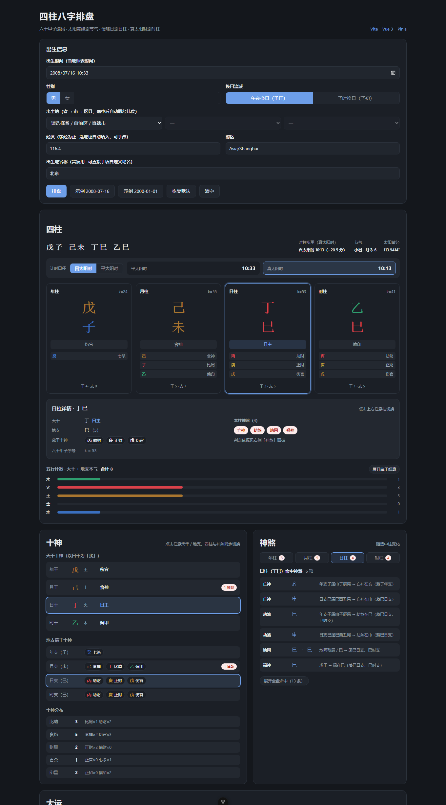

# 四柱八字排盘器

一句话：把传统查表式排盘还原为模运算 + 天文公式的 Vue3 Web 应用。



🔗 在线体验 ｜ [算法说明](doc/bazi-algorithm.md) ｜ [接口文档](doc/bazi-api.md) ｜ [调用关系图](doc/bazi-call-graph.md)

> 「在线体验」位待部署后替换；本地 `npm run dev` 即为完整功能。

## 亮点

- 干支编码用循环群 Z₁₀ / Z₁₂ / Z₆₀，合成用中国剩余定理
- 年柱 / 月柱由太阳黄经的 30° 等分点定义（立春 = 315°）
- 起运时间用牛顿迭代解节气方程，无需查表
- 真太阳时 = 平太阳时 + 经度时差 + 均时差，EoT 走解析式而非查表
- 神煞按「命中在哪一柱」定位，二十余类，逐条给出判定依据
- core 层全为纯函数，**111 项测试**全部通过

## 快速开始

```sh
npm install && npm run dev
```

其他命令：`npm run build`（类型检查 + 构建）· `npm run test:unit`（Vitest）· `npm run type-check`

**环境要求**：Node `^22.18.0 || >=24.12.0`。开发环境为 WSL2 上的 Fedora Linux 44
（`npm install` 会装平台相关的原生模块，Windows 与 Linux 的 `node_modules` 不可混用）；
迁移细节与 WSL 踩坑见 [环境说明](doc/migrate-to-wsl.md)。

## 技术栈

Vue3 · TypeScript · Vite · Pinia · Vitest

## 项目结构

```
src/
├── core/          # 纯函数，无 Vue 依赖：ganzhi / calendar / pillars / tenGods / luck / shensha / wuXing / chart
├── components/    # 8 个展示组件，不写算法
├── stores/        # Pinia：输入、结果、选中态
├── composables/   # useBazi
└── types/         # 全部类型（索引用字面量联合，禁止 any）
```

## 算法映射

| 环节 | 公式（技能章节） | 实现位置 |
| --- | --- | --- |
| 六十甲子 | `i = k mod 10`，`j = k mod 12`（§2.3） | `core/ganzhi.ts` |
| CRT 反解 | `k = CRT(i, j; 10, 12)`，要求 `i ≡ j (mod 2)` | `core/ganzhi.ts` |
| 真太阳时 | `T_solar = T_local + (lon − 120°) × 4min + EoT`（§3.1） | `core/calendar.ts` |
| 年柱 | `Y* = max{Y : t ≥ 立春(Y)}`，`k_y = (Y* − 4) mod 60`（§3.2） | `core/pillars.ts` |
| 月柱 | `m = floor(((λ − 315°) mod 360°)/30°) + 1`，`j_m = (m+1) mod 12`，`i_m = (2·i_y + m + 1) mod 10`（§3.3） | `core/pillars.ts` |
| 日柱 | `k_d = (JDN + 49) mod 60`（§3.4） | `core/pillars.ts` |
| 时柱 | `j_h = floor(((h+1) mod 24)/2)`，`i_h = (2·i_d + j_h) mod 10`（§3.5） | `core/pillars.ts` |
| 十神 | 五行生克 + 同异阴阳（§3.6） | `core/tenGods.ts` |
| 大运 | `d = +1` 阳男阴女否则 `−1`；`k_luck(n) = (k_m + d·n) mod 60`；起运 `Δ/3` 天（§3.7） | `core/luck.ts` |
| 流年 | `k_year(Y) = (Y − 4) mod 60`（§3.8） | `core/luck.ts` |
| 神煞 | 基础五类（§3.9）／扩充二十余类 + 按柱定位 | `core/shensha.ts` · `core/shenshaMore.ts` |
| 五行计数 | 天干 + 地支本气（合计 8）／含藏干，两口径 | `core/wuXing.ts` |
| 出生地坐标 | 省 → 市 → 区县 三级级联（34 / 411 / 2792） | `core/regions.ts` |
| 中间量 | 七个 step：trueSolarTime → yearPillar → monthPillar → dayPillar → hourPillar → tenGods → luckCycles（§5.2） | `core/chart.ts` |

## 验证

```
2008-07-16 10:33 男 → 戊子 己未 丁巳 乙巳   ✓
2000-01-01 00:00 男 → 己卯 丙子 戊午 壬子   ✓
2006-02-27 09:20 男 · 广西天等县 → 丙戌 庚寅 丁亥 甲辰   ✓（真太阳时 08:16）
```

节气精度实测：跨 1984–2024 六个节气时刻，与公开值相差 **−6 ~ +10 分钟**（`src/tests/accuracy.test.ts`）。

## 详细文档

- [项目历史与决策沿革](doc/history.md) —— **接手前先读**：只在对话里存在的约定与踩坑
- [算法规格（项目技能）](.dsh/skills/bazi-chart-calculator/SKILL.md) —— 公式正本，可被 Agent 按需加载
- [需求原始记录](doc/history-archive.md) —— 每次需求的原文归档（含时间戳）
- [接口文档](doc/bazi-api.md) —— 全部导出函数的签名、类型、异常与组件契约
- [算法说明书](doc/bazi-algorithm.md) —— 公式推导、边界口径、精度实测、完整算例
- [调用关系图](doc/bazi-call-graph.md) —— 分层架构、模块依赖、执行时序（9 张 Mermaid 图）
- [主截图重拍方法](doc/screenshot-howto.md) —— 无头浏览器截图步骤与踩坑记录
- [WSL 环境说明](doc/migrate-to-wsl.md) —— 迁移到 Fedora 44 的过程与 WSL 踩坑清单

## 免责声明

节气与太阳黄经为简化解析式；五行颜色与神煞表为通用版（非某一门派定本），
结果仅供研究与娱乐，不作为任何决策依据。
