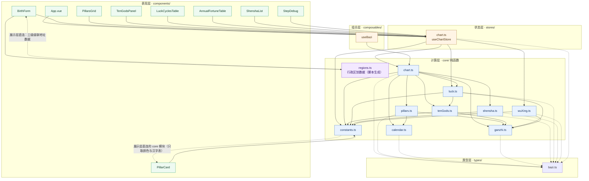
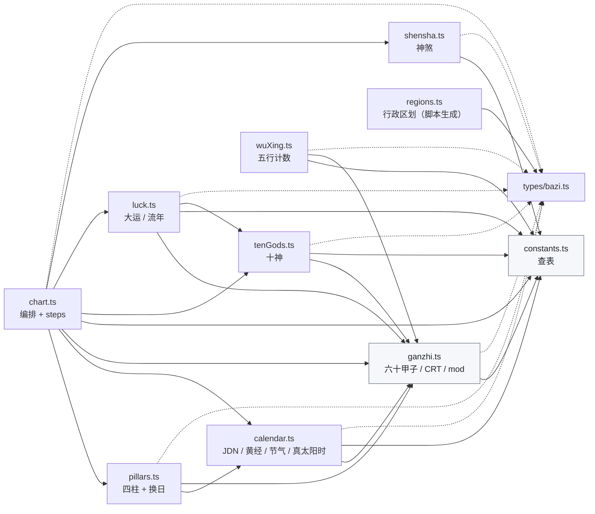
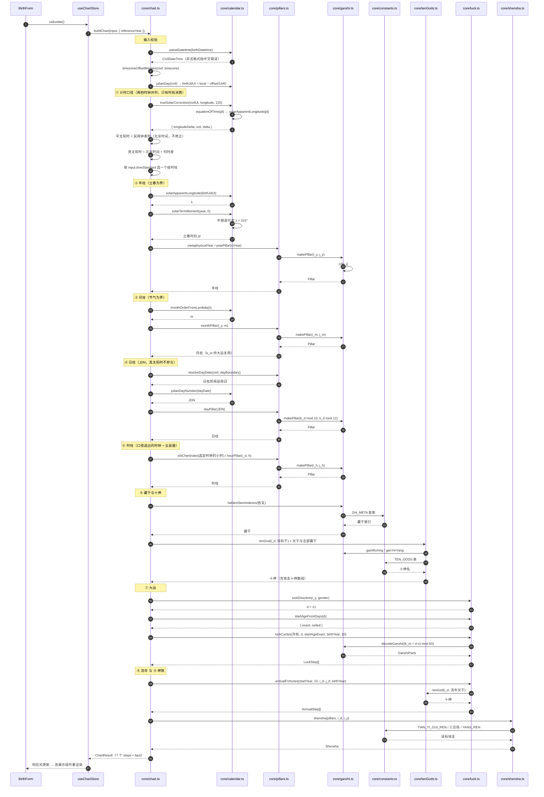
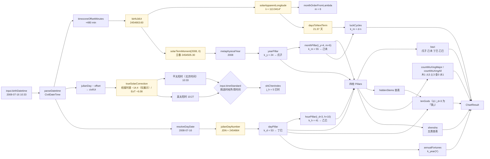
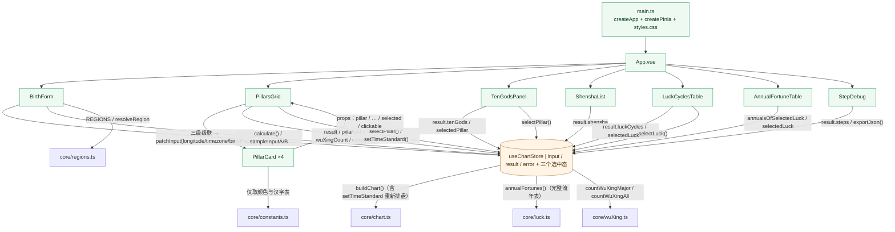
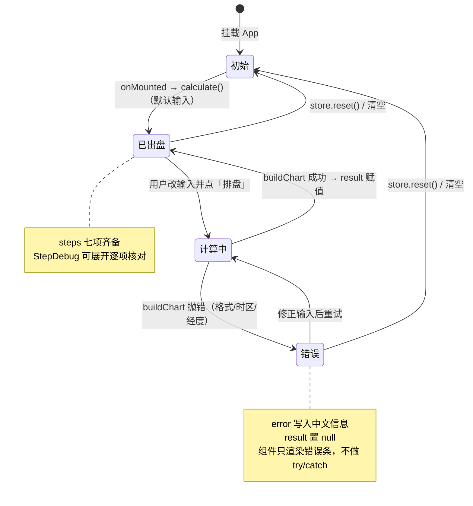
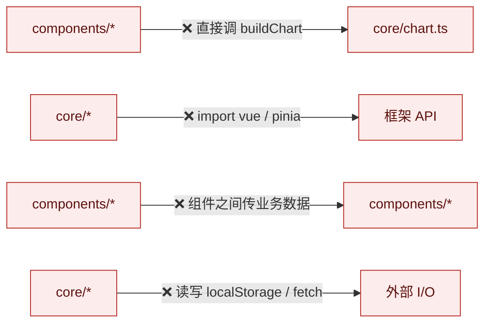
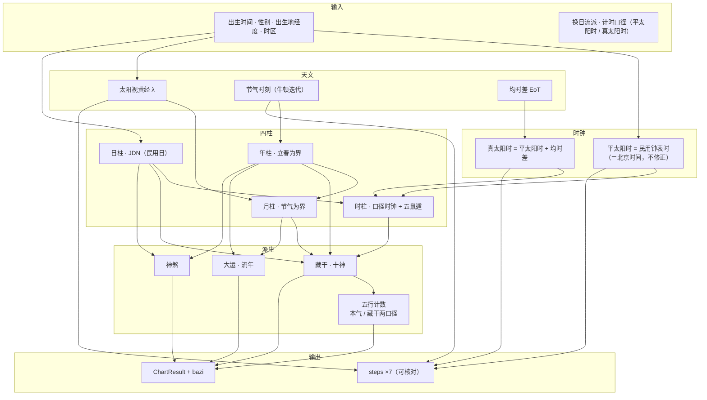

# 调用关系图

> 适用版本：`bazi@0.0.0` ｜ 接口见 [接口文档](./bazi-api.md)，算理见 [算法说明书](./bazi-algorithm.md)
> 所有图均为 Mermaid，GitHub / VS Code / Typora 可直接渲染；括号内为源码位置。

## 目录

1. [分层架构](#1-分层架构)
2. [模块依赖图](#2-模块依赖图)
3. [`buildChart` 执行时序](#3-buildchart-执行时序)
4. [数据变换链路](#4-数据变换链路)
5. [函数级调用树](#5-函数级调用树)
6. [组件树与数据来源](#6-组件树与数据来源)
7. [状态流转](#7-状态流转)
8. [依赖规则与反例](#8-依赖规则与反例)

---

## 1. 分层架构

依赖只能自上而下，箭头方向 = 允许的 import 方向。

**读图要点**

- `core/` 只依赖 `types/`，**零** Vue / Pinia 依赖 —— 所以 `vitest` 能直接测它，不需要挂载组件。
- 展示层唯一直接接触 `core` 的是 `PillarCard` 读 `constants.ts` 的颜色表（纯查表，无算法），
  其余组件一律经 store 取数。
- `useBazi`（composable）与 store 是**并列**的两条调用路径：store 是应用主路径，
  composable 面向复用（例如将来做多盘对比）。

---

## 2. 模块依赖图

只画 `core/` 内部，标出每个模块依赖谁 —— 无环，且方向单一。

**关键观察**

- `constants.ts` 与 `ganzhi.ts` 是**叶子层**（`constants` 不依赖任何同层模块，`ganzhi` 只依赖 `constants`），
  所有查表与模运算都下沉到这里 —— 这正是「所有查表放 constants、所有模运算放 ganzhi」的落地结果。
- `calendar.ts → ganzhi.ts` 只为取一个 `mod()`；这是 core 内部最小的合理耦合。
- `luck.ts → tenGods.ts` 是为了给流年补十神标注，方向是单向的，`tenGods` 不知道 `luck` 存在。
- `wuXing.ts` 只依赖 `constants`（五行归属表）与 `ganzhi`（藏干查表），与 `chart.ts` 平级：
  它是**独立可测的派生计算**，由 store 直接调用，不经过 `buildChart`（五行不进 `ChartResult`）。
- `regions.ts` 是**纯数据模块**（脚本生成的行政区划表），不依赖任何同层模块，只导出类型。
  它与 `constants.ts` 的区别：`constants` 是命理常量（天干地支等），`regions` 是地理数据。
- **无环**：任意两模块之间不存在双向依赖。

---

## 3. `buildChart` 执行时序

`store.calculate()` → `buildChart(input, { referenceYear })` 内部的真实调用顺序（与 `steps` 顺序一致）。

---

## 4. 数据变换链路

从输入到四柱的每一步变换，标注中间量的真实字段名（可在 `StepDebug` 面板逐项核对）。

---

## 5. 函数级调用树

`buildChart` 之下每个被调函数的清单（按调用先后），`⚠️` 标记会抛错的函数。

```mermaid
flowchart TD
    BC["buildChart(input, options)"]

    BC --> A1["parseDatetime ⚠️"]
    BC --> A2["timezoneOffsetMinutes ⚠️"]
    BC --> A3["julianDay / julianDayNumber"]
    BC --> A4["fromJulianDay"]
    BC --> A5["trueSolarCorrection"]
    BC --> A6["solarApparentLongitude"]
    BC --> A7["solarTermMoment"]
    BC --> A8["monthOrderFromLambda"]
    BC --> A9["resolveDayDate"]
    BC --> A10["shiChenIndex"]
    BC --> A11["shensha"]

    A5 --> B1["equationOfTime"]
    B1 --> B2["solarApparentLongitude"]
    B1 --> B3["daysSinceJ2000"]

    A6 --> B3
    A7 --> B4["牛顿迭代 ×≤12"]
    B4 --> A6
    B3 --> C1["sinDeg / cosDeg"]

    BC --> P1["yearPillar"]
    BC --> P2["metaphysicalYear"]
    BC --> P3["monthPillar"]
    BC --> P4["dayPillar"]
    BC --> P5["hourPillar"]
    P1 --> G1["makePillar → crt ⚠️"]
    P3 --> G1
    P4 --> G2["mod(k_d + 49, 60)"]
    P4 --> G1
    P5 --> G1

    BC --> T1["tenGod"]
    BC --> T2["branchTenGods"]
    T2 --> G3["hiddenStemIndexes → ZHI_META"]
    T2 --> T1
    T1 --> G4["ganWuXing / ganYinYang"]
    T1 --> C2["TEN_GODS 表"]

    BC --> L1["luckDirection"]
    BC --> L2["startAgeFromDays"]
    BC --> L3["luckCycles"]
    BC --> L4["annualFortunes"]
    L3 --> G5["decodeGanzhi"]
    L4 --> T1
    L4 --> C3["isLiuChong / isLiuHe"]

    A11 --> C4["TIAN_YI_GUI_REN"]
    A11 --> C5["sanHeHead → taoHuaOf / yiMaOf / huaGaiOf"]
    A11 --> C6["YANG_REN"]

    BC --> Z1["round / pad2 / formatCivil（内部格式化）"]
    BC --> Z2["steps.push × 7"]

    classDef err fill:#fdecec,stroke:#b3261e,color:#5c120e
    class A1,A2,G1 err
```

---

## 6. 组件树与数据来源

**数据流方向**：组件 →（action）→ store →（纯函数）→ core →（返回值）→ store →（响应式）→ 组件。
没有任何组件直接调 `core` 的算法函数；组件之间只下传展示 props（`PillarCard` 收 `PillarsGrid` 的 props）。

**两个"展示层直连 core"的例外，都是纯数据/纯查表**：`PillarCard` ← `constants.ts`（五行颜色），
`BirthForm` ← `regions.ts`（行政区划三级数据）。算法调用一律经 store。

**跨组件选中态统一放 store**：`selectedPillar` / `selectedTenGodKey` / `selectedLuckN`。
因此四柱页、十神页、大运页、流年页四处的高亮与过滤天然同步，不需要组件间通信。

---

## 7. 状态流转

---

## 8. 依赖规则与反例

### 8.1 允许

| 方向 | 例子 |
| --- | --- |
| `components` → `stores` | `BirthForm` 调 `store.calculate()`；`PillarsGrid` 调 `setTimeStandard()` |
| `components` → `core/constants` | `PillarCard` 取五行颜色（纯查表） |
| `components` → `core/regions` | `BirthForm` 取三级行政区划（纯数据） |
| `stores` → `core` | `chart.ts` 调 `buildChart()` / `annualFortunes()` / `countWuXingMajor()` |
| `composables` → `core` | `useBazi.run()` 调 `buildChart()` |
| `core` 内部向下 | `chart` → `pillars` → `ganzhi` → `constants` |

### 8.2 禁止（若出现即为设计事故）

**为什么这几条必须守住**

1. 组件直接调 `core`：绕过 store 的单一数据源，改一个地方要改多处，且 `steps` 与 UI 可能不同步。
2. `core` 引入框架：`vitest` 就得起 jsdom 才能测算法，纯函数可测性丧失。
3. 组件互传业务数据：出现「谁是数据主人」的歧义，刷新时序敏感。
4. `core` 做 I/O：纯函数可复现性被破坏，`buildChart` 将无法用于批量校验。

`core` 中唯一的时间依赖是流年起始年，已通过 `options.referenceYear` 显式注入，
使 `buildChart` 在给定 options 下仍是可复现的纯函数（见 [算法说明书 §12](./bazi-algorithm.md#12-流年)）。

---

## 附：一图速览

